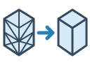

# Simplify Mesh

Simplify Mesh reduces mesh detail on selected objects. Use it to reduce a dense
mesh before continuing to model or exporting. Optional smoothing and refinement
controls let you adjust the surface afterward.

Simplification can remove small features. Start with a low tolerance when working
with thin walls, small holes, or parts that must fit together, and inspect the
result before exporting.

## Simplify selected objects

1. Open your model in **Advanced mode**.
2. Select the objects you want to simplify.
3. Click **Simplify mesh** in the toolbar. Its icon shows a dense mesh becoming a
   simpler mesh. It is immediately to the left of the conversion buttons, separated
   from them by a vertical divider.
4. Select one of the affected objects to show its settings in the shape
   customization panel.
5. Adjust `simplify` and press **Enter** to apply the value.

The default `simplify` tolerance is **0.5 model units**. Smoothing and refinement
start disabled, so clicking the button applies simplification only. Other objects
in the scene are left unchanged.

A larger `simplify` tolerance allows more detail to be removed. A smaller positive
value preserves finer features. The value is a distance tolerance, rather than a
percentage of triangles to remove, so the reduction depends on the input mesh.

If you selected several objects when creating the step, they share its settings.
Select one of those objects to edit the settings for the whole step. Each edit
recalculates from the mesh entering that step, instead of repeatedly simplifying
the previous result. Use **Undo** to remove the step if needed.

## Settings

Decimal settings use typable numeric fields. Integer settings provide a list of
options. The names below match the labels in the customization panel.

For each method control, **0 or a negative value disables that method**. A positive
value enables it. `normalAngle` and `smoothness` are supporting settings rather
than separate methods; changing either alone leaves smoothing disabled.

| Setting | Default | Effect |
| --- | --- | --- |
| `simplify` | `0.5` | Distance tolerance for removing mesh detail, in model units. Increase gradually for stronger simplification. |
| `smoothOut` | `0` | Enables smoothing with a crease-angle threshold in degrees. Edges sharper than the threshold remain sharp when `smoothness` is `0`. Higher angles allow more edges to be smoothed. |
| `smoothness` | `0` | Adjusts sharp-edge blending for `smoothOut`, from `0` to `1`. At `0`, the crease-angle threshold controls which edges remain sharp; at `1`, smoothing extends across all angles. |
| `calculateNormals` | `0` | Calculates surface normals for smoothing. Choices are `0`, `1`, `2`, and `3`; positive values select a normal-data channel, rather than smoothing strength. |
| `smoothByNormals` | `0` | Smooths using a normal-data channel. Choices are `0`, `1`, `2`, and `3`. The required normals are prepared automatically. |
| `normalAngle` | `60` | Crease-angle threshold in degrees for `calculateNormals` and `smoothByNormals`, from `0` to `180`. |
| `refine` | `0` | Subdivides each edge into the chosen number of pieces. Choices are `0`, `1`, `2`, `3`, `4`, and `8`. Choose `2` or more to add detail; `1` leaves the mesh unchanged at this stage. |
| `refineToLength` | `0` | Subdivides edges longer than this distance in model units. Smaller positive values produce a denser mesh. |
| `refineToTolerance` | `0` | Refines a smoothed surface to this distance tolerance in model units. Smaller positive values give a closer approximation with more triangles. Without smoothing, planar geometry stays unchanged. |

## Adjust refinement

Refinement adds triangles, so it can increase mesh size after simplification.
Leave all refinement controls at `0` when your goal is simply to reduce mesh
complexity.

To add a controlled amount of detail after simplifying:

1. Keep your chosen `simplify` tolerance.
2. Set `refine` to `2` to split each edge into two pieces, or set
   `refineToLength` to a desired maximum edge length.
3. Inspect the result before increasing refinement further.

For a smoother surface:

1. Start with `smoothOut` at `60` degrees and `smoothness` at `0`.
2. Increase `smoothOut` gradually if you want more edges to be smoothed.
3. For distance-based control of the curved surface, set `refineToTolerance` to a
   small positive value appropriate for the size of the model.

Smoothing can change dimensions and round features. Check holes, mating surfaces,
and sharp corners after enabling it. Refinement alone adds mesh detail while
preserving the shape.

When smoothing is enabled and all refinement controls are disabled, the operation
automatically subdivides edges into two pieces to represent the smoothed surface.
An enabled refinement control replaces this automatic subdivision. Avoid
`refine = 1` when you want refinement to reveal the smoothed surface, since that
value leaves the mesh unchanged at the refinement stage.

If several methods are enabled, they run in this order: simplification, normal
calculation, normal-based smoothing, smooth-out, subdivision by count, refinement
to length, and refinement to tolerance. Start with one smoothing method and one
refinement control so that each adjustment is easier to evaluate.
